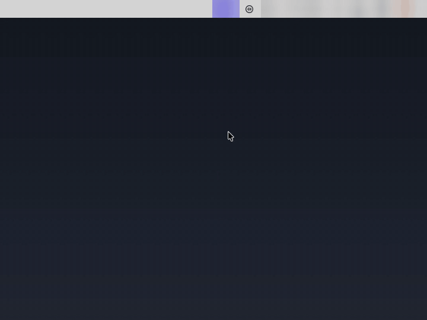

# Minutes

A tiny macOS menu-bar app that records your calls (Zoom, Google Meet, Teams, Slack huddles, anything) and transcribes them on your Mac, with each line labelled **Me** or **Them**.



([MP4 version](docs/menu-demo.mp4))

## Why

Most call recorders join the meeting as a bot, upload your audio to someone's cloud, or only work with one app. Minutes does none of that:

- **Works with every call app.** It records what your Mac plays (the other participants) plus your microphone, so there's nothing to install per app and no bot in the meeting.
- **Stays on your Mac.** Recording and transcription run locally with [whisper.cpp](https://github.com/ggml-org/whisper.cpp). No account, no upload.
- **Knows who said what.** Your mic and the call are captured as separate tracks, so the transcript says "Me" or "Them" with a timestamp on each line.
- **Out of the way.** One click in the menu bar to start and stop. You get a `.m4a` and a `.txt` in `~/Recordings`.

A transcript looks like this:

```
[00:00:03] Them: Hi team, thanks for joining. Let's start with the roadmap update.
[00:00:09] Me: Sounds good, I'll share my screen.
```

Recording laws vary: let the people on the call know you're recording.

## Download

Grab `Minutes.zip` from the [latest release](https://github.com/boyanangelov/minutes/releases/latest), unzip it and move `Minutes.app` to Applications.

The app isn't signed with an Apple Developer ID, so macOS blocks it the first time. To open it anyway: right-click the app and choose **Open**, or go to **System Settings ▸ Privacy & Security** and click **Open Anyway**. You can also clear the quarantine flag from a terminal:

```sh
xattr -dr com.apple.quarantine /Applications/Minutes.app
```

For transcripts, also install whisper.cpp:

```sh
brew install whisper-cpp
```

The first transcript downloads the model (~32 MB) to `~/Library/Application Support/Minutes/`.

## Requirements

- An Apple Silicon Mac (M1 or later) running macOS 14.4 (Sonoma) or later. Earlier versions lack the Core Audio API for capturing system audio.
- [Homebrew](https://brew.sh) `whisper-cpp` for transcription (optional; recording works without it)
- To build from source: the Xcode Command Line Tools (`xcode-select --install`)

## Build & run

```sh
./build.sh
open build/Minutes.app
```

Always launch the `.app` rather than the bare binary: macOS reads the permission prompts from the app bundle.

Click the waveform icon in the menu bar, then **Start Recording**. The icon turns red with a timer, and the menu shows live levels for *Call* and *Mic*. **Stop Recording** saves `~/Recordings/Minutes YYYY-MM-DD HH-mm-ss.m4a`, and the transcript `.txt` follows a few seconds later.

- **Recent Recordings** / **Open Recordings Folder**: quick access to your files.
- **Transcribe Recordings**: turn transcription on or off.
- **Also Keep Separate Mic/System Tracks**: keep the raw `.caf` tracks next to the mix.
- Quitting while recording saves the recording first.

## Permissions

The first recording asks for two permissions:

1. **Microphone**, for your voice.
2. **System Audio Recording** (System Settings ▸ Privacy & Security ▸ *Screen & System Audio Recording*), for the call.

Without the second one, macOS hands the app silence instead of an error. Minutes shows ⚠︎ in the menu bar if no call audio arrives in the first 15 seconds, and warns you when you stop.

Do a short throwaway recording first to get through both prompts.

## Start at login

Tick **Start at Login** in the menu-bar menu. It writes a LaunchAgent (`~/Library/LaunchAgents/io.github.boyanangelov.minutes.plist`) pointing at the running copy of the app, and unticking removes it. The change applies from your next login.

Or install it into `~/Applications` and register it for login in one go:

```sh
./install.sh
```

The script prints the uninstall command.

## Transcription

- **Engine:** whisper.cpp, Metal-accelerated on Apple Silicon. Transcribing takes a few seconds per minute of audio on an M1.
- **Model:** Whisper `tiny`, quantised to q5_1 (~31 MB). It's the smallest Whisper model and handles many languages. A Silero voice-activity model (<1 MB) skips silences, so Whisper doesn't invent text in them.
- **Language** is detected per track from the first 30 seconds, so a call that switches language midway is transcribed in the first one.
- **Accuracy:** tiny is good for the gist and for search, but rough on names and non-English speech. For better transcripts, put `ggml-base-q5_1.bin` (~57 MB) or `ggml-small-q5_1.bin` (~190 MB) from [the whisper.cpp models](https://huggingface.co/ggerganov/whisper.cpp/tree/main) in `~/Library/Application Support/Minutes/` and change `modelName` in `Sources/Minutes/Transcriber.swift`.
- **Speakers vs. headphones:** on laptop speakers your mic also hears the call, so some "Them" lines can show up again as "Me". Headphones avoid this.

## How it works

- **Call audio:** a global Core Audio process tap (`CATapDescription`) inside a private aggregate device. Your audio keeps playing normally.
- **Your voice:** `AVAudioEngine` records the default input on its own track.
- **Bluetooth headsets:** when a call app opens a headset's mic, the headset switches into call mode (for example from 44.1 kHz to 16 kHz). Minutes opens the mic before tapping, and rebuilds the tap if the output device or its sample rate changes, or if the stream stalls. Any gap is filled with silence so the tracks stay in sync.
- **On stop:** both tracks are resampled to 48 kHz, aligned by their start times, mixed and encoded as AAC. Each track is then transcribed separately and the lines are merged by time.

To see what the capture is doing, run a self-test. It records for 10 seconds, logs formats, restarts, levels and the saved file, then quits:

```sh
open -W --stderr /tmp/minutes.log build/Minutes.app --args --selftest 10
```

If permissions get stuck after rebuilding (the ad-hoc signature changes on each build):

```sh
tccutil reset Microphone io.github.boyanangelov.minutes
tccutil reset AudioCapture io.github.boyanangelov.minutes
```

## Known limitations

- You start and stop recording yourself; Minutes doesn't detect calls.
- The mic follows the system default input. Switching input mid-call restarts it, and the short gap is filled with silence.
- Quitting while a transcript is being made cancels that transcript. The recording itself is already saved.

## License

[MIT](LICENSE)
